<div align="center">


# NexBus: Smart Bus Tracking & Fleet Management Platform

**A role-based web platform that digitises Sri Lanka's public and private bus operations, from live GPS tracking to fleet, staff, revenue and performance analytics.**


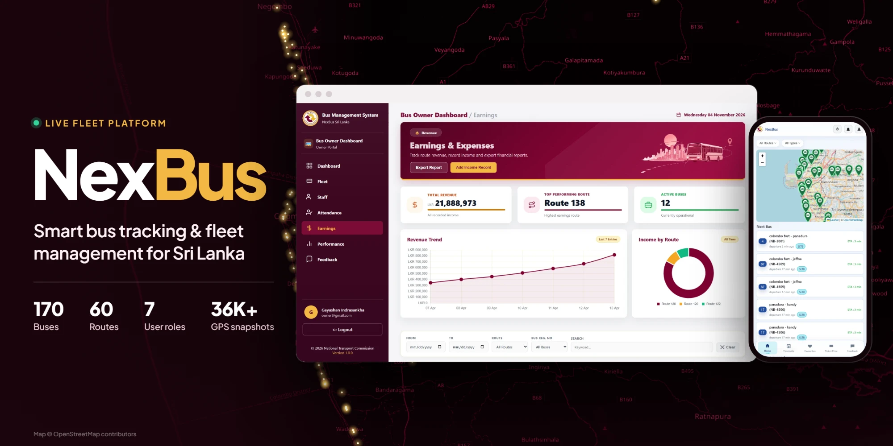

<sub><i>The Bus Owner Portal: the module I led, redesigned and built most of.</i></sub>

</div>

---

## 📌 At a Glance

| | |
|---|---|
| **What it is** | A full-stack web platform for the National Transport Commission (NTC), SLTB depots, private bus owners, timekeepers and passengers |
| **Problem solved** | Bus operations in Sri Lanka still run on paper logs, phone calls and spreadsheets, so nobody has a live view of where buses are or how the fleet is performing |
| **Scale of the system** | 7 user roles · 95 routes/endpoints · 30 relational tables · **36,000+ GPS snapshots** · 170 buses (62 private + 108 SLTB) · 60 routes |
| **Team** | 4 developers working through Git and GitHub with a shared custom MVC framework |
| **My role** | **Lead developer of the Private Bus Owner module**: database migrations, backend, frontend and UI/UX across all 8 pages, plus fixes in shared modules |
| **My footprint** | 60+ commits · **~80% of the owner module's current code** (≈14,800 of 18,600 lines by `git blame`) across its controller, 9 models, 9 views, CSS and JS |

---

## 👨‍💻 My Contribution: The Private Bus Owner Portal

I led the **Private Bus Owner** role. It's the part of NexBus that a private bus company uses to run its business every day. A teammate set up the first scaffold. I then rebuilt and extended it into the current module: the database migrations, controller logic, models, views, client-side JavaScript and the complete visual redesign.

### What I built

| Page | What it does | Engineering highlights |
|---|---|---|
| **🏠 Dashboard** | Greeting hero, fleet KPIs, a live map of the owner's buses, quick actions and fleet status alerts | Live Leaflet map that refreshes every 15 s from an **owner-scoped JSON API** I wrote (`/B/live`) |
| **🚌 Fleet Management** | Add, edit and delete buses; assign drivers and conductors; filter by route, class, age and assignment | Assignment is **locked automatically** when a bus goes to *Maintenance* or *Out of Service*, and the assigned staff are released. Deletes run inside a **PDO transaction** that cascades through trips, assignments, timetables and earnings |
| **👥 Staff (Drivers & Conductors)** | Separate registries with profiles, status (Active/Suspended) and KPI cards | Every status change is written to an **audit table** (`private_staff_status_logs`) with the old status, new status, reason and timestamp |
| **✅ Attendance** | Mark daily attendance (Present, Absent, Late, Half Day) for all staff, with history and per-person filters | Suspended staff are locked out of marking. Bulk save uses an upsert, and summary rates are computed over 30 days |
| **💰 Earnings & Expenses** | Record income per bus, view the revenue trend and income by route, export reports | Chart.js line and doughnut charts, redesigned earnings table and data fetching, CSV report export. Ownership is checked before every write |
| **📊 Performance Analytics** | Live KPIs (delayed buses, driver rating, speed violations, long waits), live fleet speed, analytics charts and a fleet table | Drill-down modals for each KPI, plus a **composite reliability score** I designed (see below) |
| **💬 Feedback** | Passenger complaints and feedback for the owner's buses, with status workflow and replies | Filter by status and type, search, and track resolved vs. pending |
| **👤 Profile** | Update details, change password, delete account | Password hashing and verification |

### Technical decisions I'm proud of

- **Multi-tenant data isolation.** Every query in the owner module is scoped to the logged-in operator's `private_operator_id`, so one bus company can never read or change another company's buses, staff, earnings or GPS data. Ownership is checked again before each update or delete, not just when the page loads.
- **A composite driver reliability score (0–10).** Raw GPS data doesn't tell you who is a "good" driver, so I wrote a SQL scoring expression that blends three signals:

  ```text
  score = 0.45 × on-time score  +  0.35 × (100 − 6 × avg delay minutes)  +  0.20 × (100 − 100 × speed violations)
  ```

  It falls back gracefully when a stored `reliability_index` is missing, which keeps the KPI meaningful for buses that only have live snapshots.
- **Business rules in the data layer.** For example, a bus in maintenance can't be assigned a driver. The rule is enforced in the SQL `UPDATE ... WHERE status NOT IN ('Maintenance','Inactive')` itself, so the UI can't bypass it.
- **Validation in layers.** Validation runs in modal forms on the client side, backed by a fluent server-side `Validator` (`required()->integer()->...`) for name formats, licence numbers, phone numbers and registration numbers.
- **UI/UX redesign.** I redesigned the whole portal (sidebar, hero banners, KPI cards, empty states and responsive grids) into a consistent design system scoped with CSS so the other modules weren't affected.

---

## 🖼️ Screenshots

### Private Bus Owner Portal (my module)

<table>
  <tr>
    <td width="50%">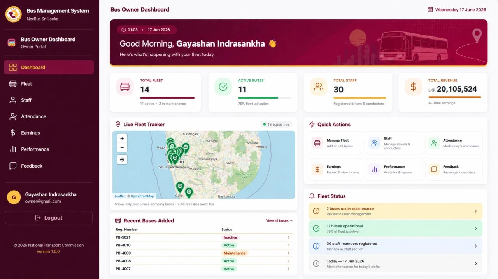<br/><b>Dashboard</b>: KPIs, live fleet tracker and fleet status</td>
    <td width="50%">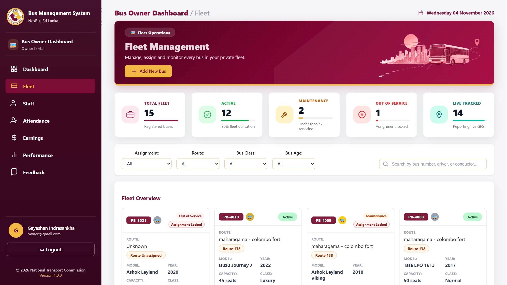<br/><b>Fleet Management</b>: status, assignment locks and live location per bus</td>
  </tr>
  <tr>
    <td>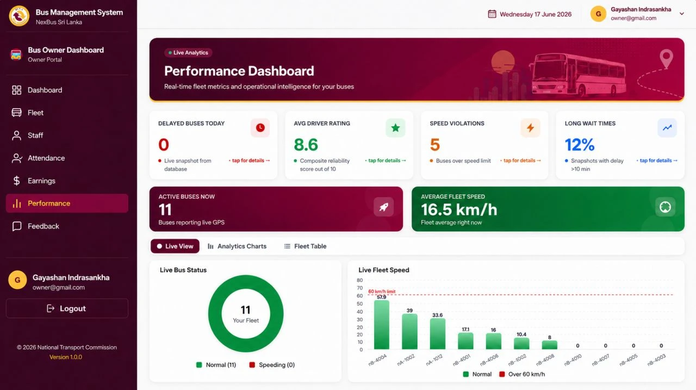<br/><b>Performance</b>: real-time KPIs and live fleet speed against the 60 km/h limit</td>
    <td>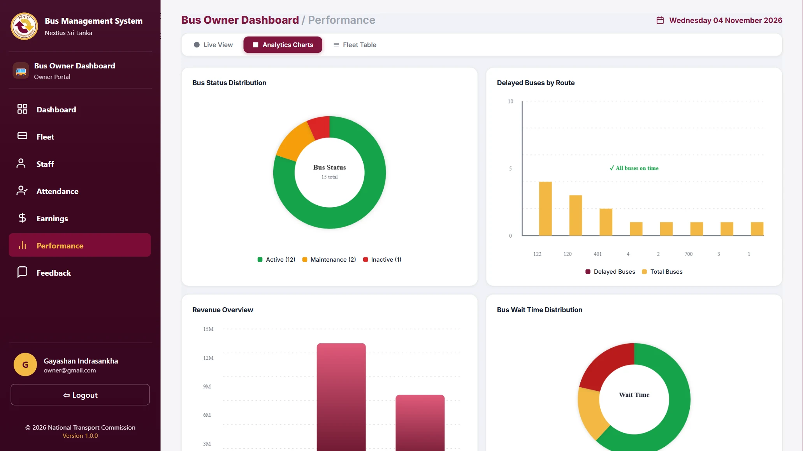<br/><b>Analytics Charts</b>: bus status, delays by route, revenue and wait times</td>
  </tr>
  <tr>
    <td>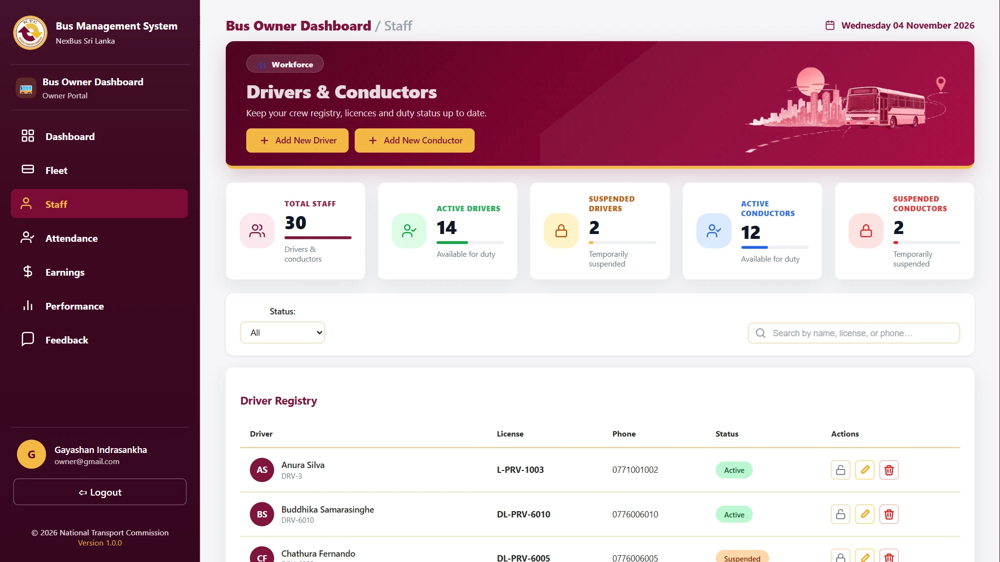<br/><b>Drivers & Conductors</b>: staff registry with status and audit trail</td>
    <td>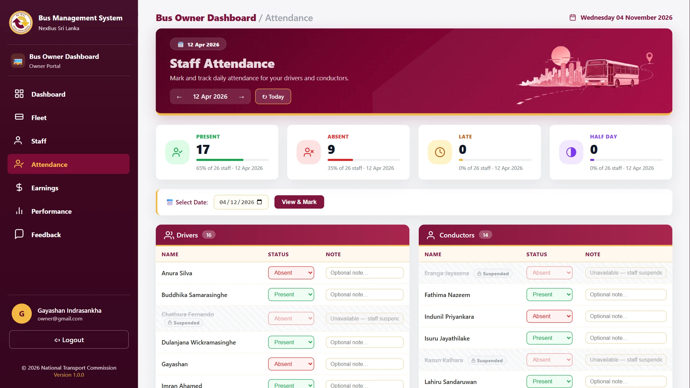<br/><b>Attendance</b>: daily marking, with suspended staff locked out</td>
  </tr>
  <tr>
    <td colspan="2" align="center">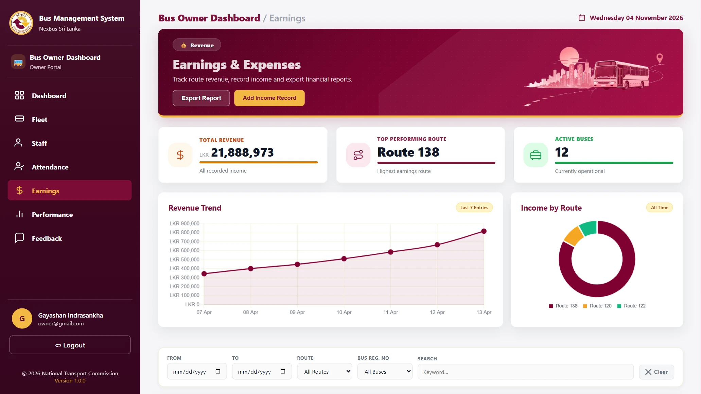<br/><b>Earnings & Expenses</b>: revenue trend, income by route and CSV export</td>
  </tr>
</table>

### Other parts of the platform (team modules)

<table>
  <tr>
    <td width="36%" align="center">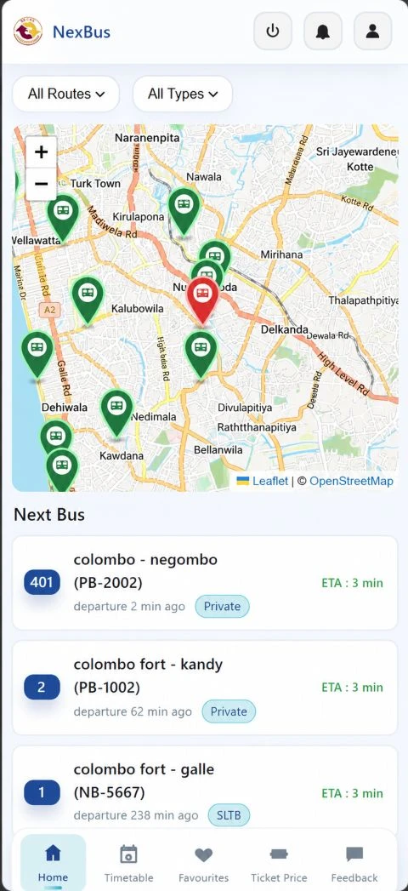<br/><b>Passenger app (mobile)</b>: live map and next-bus ETA</td>
    <td width="64%">
      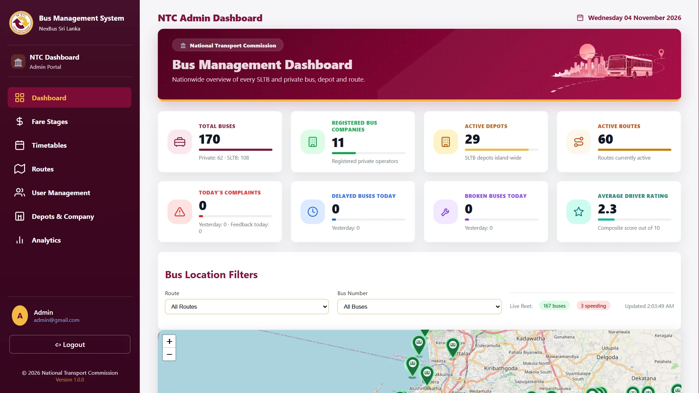<br/><b>NTC Admin</b>: nationwide view of 170 buses, depots and routes<br/><br/>
      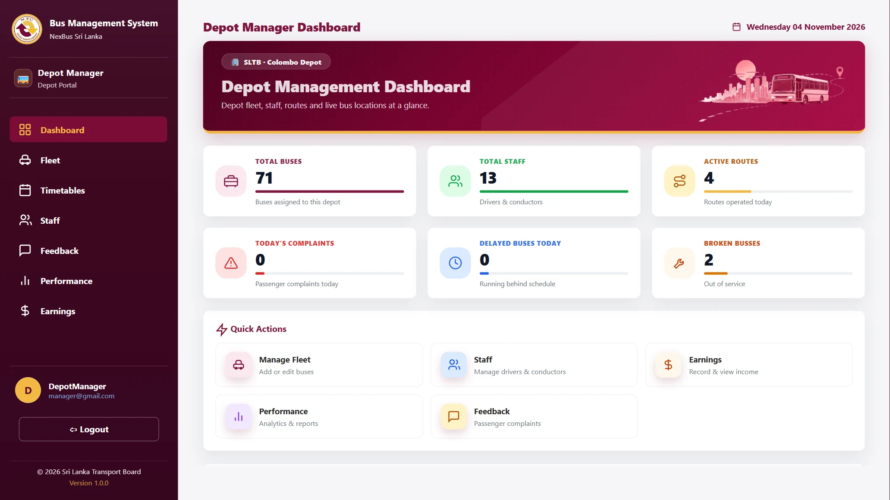<br/><b>SLTB Depot Manager</b>: depot fleet, staff and live tracking
    </td>
  </tr>
</table>

---

## 🏗️ System Architecture

NexBus runs on a **custom-built MVC framework**. There's no Laravel or Symfony underneath, so the team wrote its own front controller, router, autoloader, middleware and base classes.

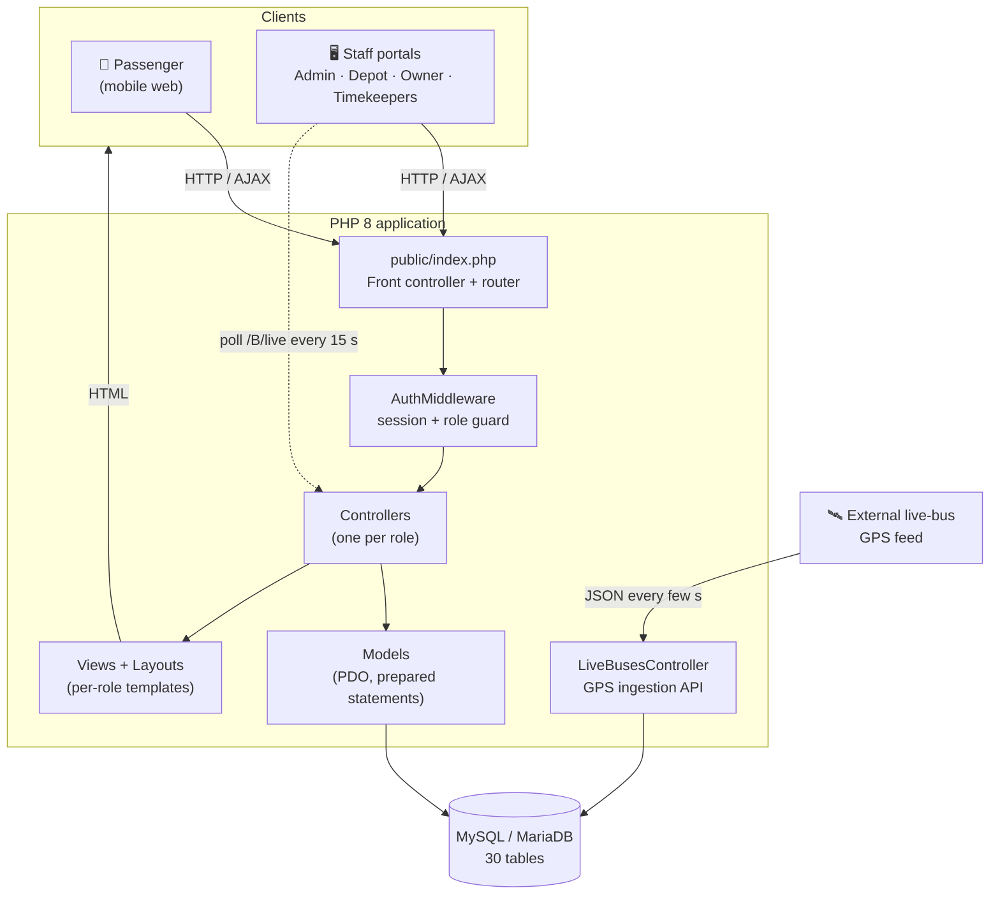

### Request lifecycle

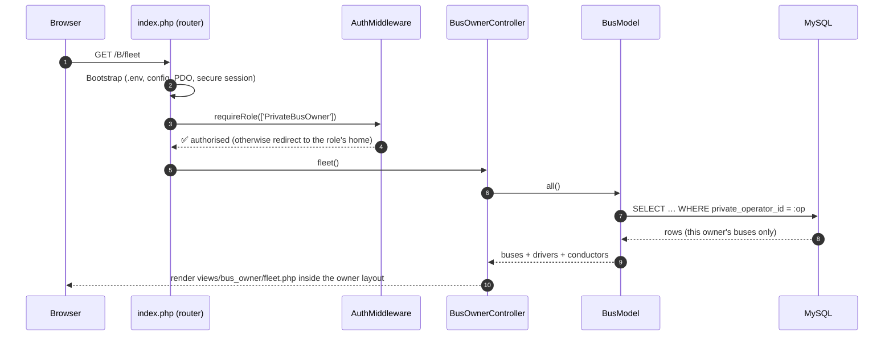

### Live GPS tracking pipeline

The team built the shared ingestion layer. I built the owner-scoped feed (`/B/live`) and the dashboard map and Performance KPIs that consume it.

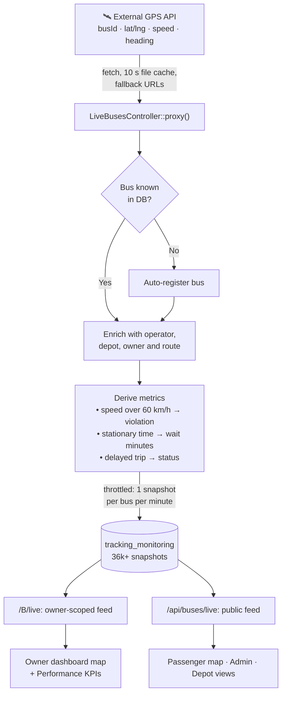

---

## 🗄️ Database Design (core entities of the Bus Owner module)

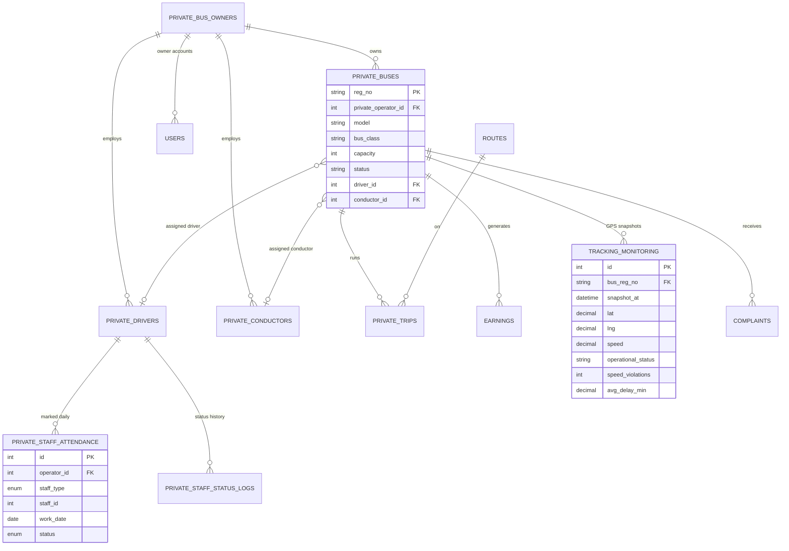

The full schema has **30 tables** covering SLTB depots, timetables, fares, assignments, trips, direct messaging, notifications and passenger favourites. I wrote the owner-module migrations in [`database/migrations`](database/migrations), including staff attendance, staff status logs and bus profile fields.

---

## 👥 User Roles

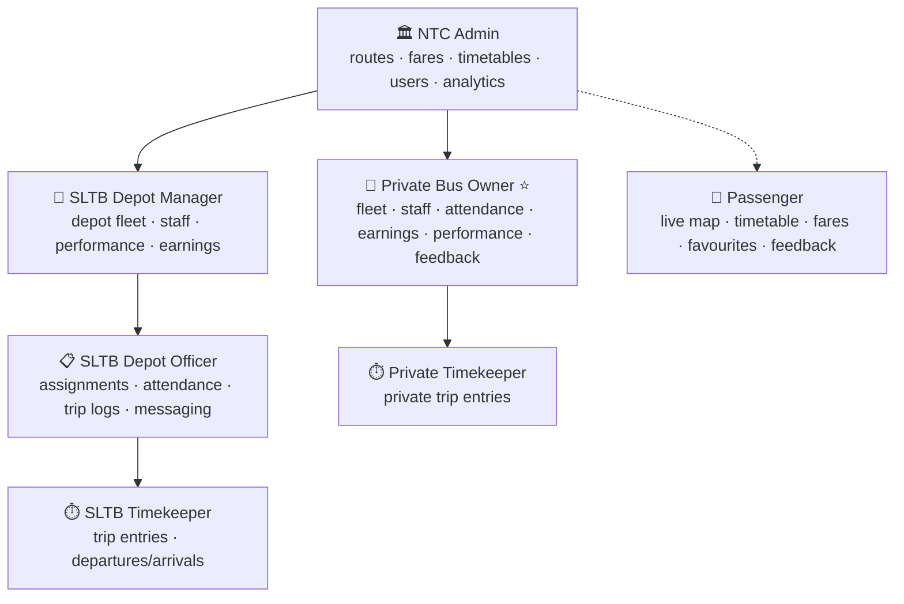

<sub>⭐ = the module I built.</sub>

Access is enforced centrally. Every URL prefix (`/A`, `/M`, `/O`, `/B`, `/TP`, `/TS`) maps to an allowed role in the front controller, and anyone without that role is redirected to their own home page.

---

## 🔐 Security & Quality Practices

- **SQL injection protection.** All queries use PDO prepared statements with `ATTR_EMULATE_PREPARES = false`.
- **Session hardening.** Sessions use strict mode, `HttpOnly` and `SameSite=Lax` cookies, `Secure` over HTTPS, and `session_regenerate_id()` at login.
- **Passwords.** Passwords are stored as `password_hash()` and checked with `password_verify()`.
- **Role-based access control.** The middleware checks the role on every request, and each controller guards itself again with `requireLogin([...])`.
- **Tenant isolation.** Owner-scoped queries and ownership checks run before writes (see above).
- **CSRF protection.** Tokens protect the timekeeper trip-entry forms.
- **Output escaping.** Views escape output with `htmlspecialchars`.
- **Operational logging.** Errors go to daily log files in `logs/`.

---

## 🛠️ Tech Stack

| Layer | Technologies |
|---|---|
| **Backend** | PHP 8.2 (strict types, namespaces, PSR-4-style autoloader), custom MVC, PDO |
| **Database** | MySQL / MariaDB, SQL migrations, seed scripts |
| **Frontend** | HTML5, CSS3 (custom design system, responsive grid), vanilla JavaScript, AJAX/Fetch |
| **Maps & charts** | Leaflet 1.9 + OpenStreetMap, Chart.js 4 |
| **Real-time** | GPS polling API, Server-Sent Events for depot messaging |
| **Tooling** | Git & GitHub (multi-developer workflow), XAMPP, phpMyAdmin, VS Code |

---

## 📂 Project Structure

```text
NexBus/
├── public/            # Front controller (index.php), CSS, JS, images
│   └── assets/js/analytics/   # Chart.js and Leaflet modules (live fleet, revenue, delays…)
├── bootstrap/         # App bootstrap (env, config, PDO, session) + autoloader
├── config/            # App and database config (read from .env)
├── Middleware/        # AuthMiddleware: login + role guard
├── Support/           # Env loader, fluent Validator, DepotLocator
├── controllers/       # One controller per role + LiveBusesController (GPS API)
├── models/            # Per-role model folders (bus_owner/, depot_manager/, …)
├── views/             # Per-role views + Layouts/
├── database/          # Full DB dump + migrations
├── scripts/           # Seeding, diagnostics and migration helpers
└── docs/screenshots/  # README images
```

---

## 🚀 Run It Locally

**Requirements:** PHP 8.1+ and MySQL/MariaDB (XAMPP works out of the box).

1. **Clone the repository**
   ```bash
   git clone https://github.com/gayashan-indrasankha/NexBus.git
   ```
2. **Create the database.** Create a database named `nexbus` and import `database/CompletedDB.sql` with phpMyAdmin (the dump is UTF-16 encoded, which phpMyAdmin detects automatically).
3. **Configure the environment.** Set your `DB_*` values in `.env`.
4. **Start the server** from the project root:
   ```bash
   php -S localhost:8000 -t public
   ```
5. **Open the app** at `http://localhost:8000/login` and sign in with a seeded account for the role you want to explore.

---

## 🤝 Team

NexBus was built by a team of four developers. Each of us owned one or more user roles, and we all shared the core framework.

| Developer | Focus |
|---|---|
| **[Gayashan Indrasankha](https://github.com/gayashan-indrasankha)** | **Private Bus Owner portal**: fleet, staff, attendance, earnings, performance analytics, feedback and UI redesign |
| [Yomal Kannangara](https://github.com/yomalkannangara) | Core framework and folder structure, NTC Admin, live GPS ingestion, initial module scaffolds |
| [ShamuHe](https://github.com/ShamuHe) | SLTB Depot Officer and SLTB/Private Timekeeper modules |
| [Pasindu Dhanushka](https://github.com/Pasindu-Dhanushka) | SLTB Depot Manager module |

---

<div align="center">

### 📫 Let's connect

**Gayashan Indrasankha** · Full-Stack Developer

[](https://github.com/gayashan-indrasankha)
[](mailto:gayashanindrasankha@gmail.com)

<sub>If this project interests you, I'd be happy to walk you through the code, the architecture decisions or a live demo.</sub>

</div>
